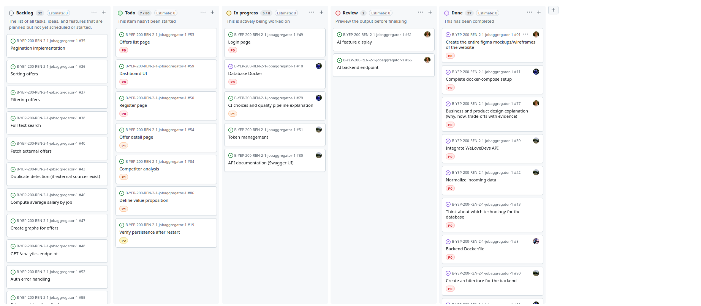

# Project Management

---

### What

- Thanks to github project, we could organize between each other about all tasks to do.
- We add prioritization grade on tasks to see which tasks is important to do first, which tasks is in progress , which tasks is done etc. (see evidence for an example)
- Github actions improved communication, organization, project management.

### Who

- All team members used the Kanban to manage and track project tasks.
- The project manager/team leader supervised task organization and prioritization.

### When

- At the beginning of the project, after the project brainstorm, project Kanban was the first task to do at first.

### Evidences

